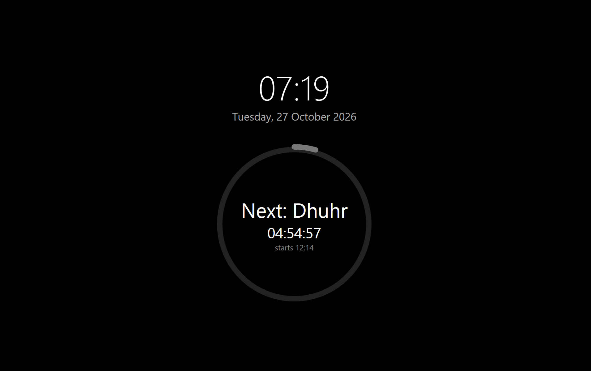
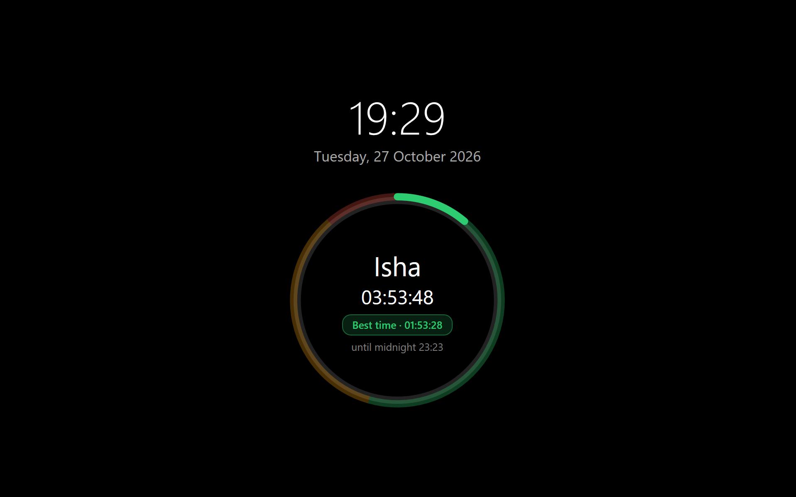
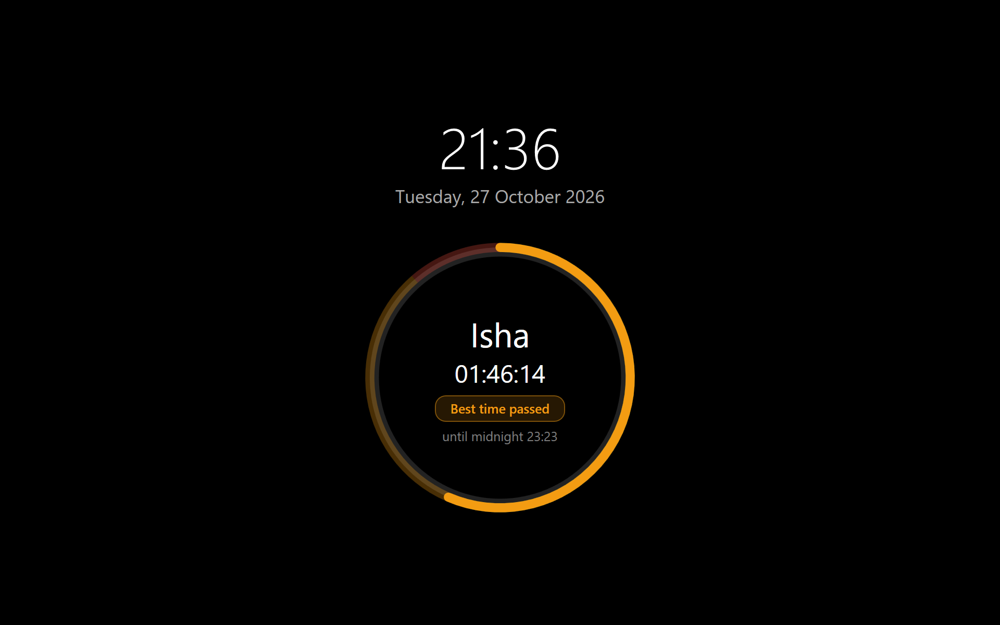
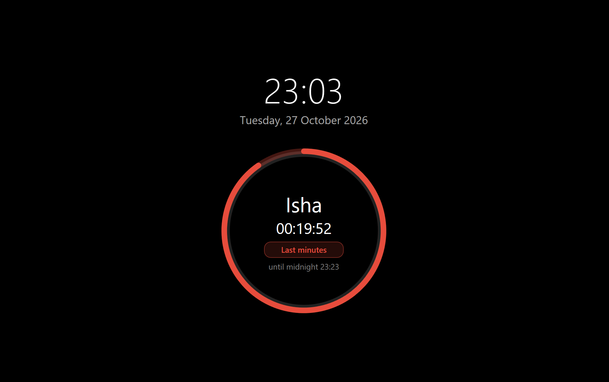

# PrayerSaver

A Windows screensaver that shows Islamic prayer times as a live progress ring: current prayer, time left in its window, and a separate countdown for the best time to pray. Current time and date are shown above the ring.

<!--  -->
<p align="center">
  
  
  
  
</p>

## Features

- Native Windows screensaver (`.scr`) built with C# and WPF
- Progress ring with green (best), orange and red (last minutes) zones
- Large clock and date, "best time" countdown and window countdown
- Prayer times from the [AlAdhan API](https://aladhan.com/prayer-times-api), cached daily in `%AppData%` for offline use
- Exits on any key, click or larger mouse movement

## Prayer windows

| Prayer | Window | Green (best time) | Red (last minutes) |
|---|---|---|---|
| Fajr | Fajr to sunrise | First half | Last 20 min |
| Dhuhr | Dhuhr to Asr | First half | Last 30 min |
| Asr | Asr to sunset | Until 40 min before sunset | Last 15 min |
| Maghrib | Maghrib to Isha | First 20 min | Last 20 min |
| Isha | Isha to Islamic midnight | Until first third of the night | Last 30 min |

Orange is the time between green and red. Between windows the ring is grey and counts down to the next prayer. Values are practical defaults, not a fatwa; scholars differ. Adjust them in `Store.BuildWindows` (`Program.cs`). Always verify times with your local mosque.

## Requirements

- Windows 10/11 (x64) with the [.NET 10 Desktop Runtime](https://dotnet.microsoft.com/download/dotnet/10.0)
- [.NET 10 SDK](https://dotnet.microsoft.com/download/dotnet/10.0) to build (Windows, macOS or Linux)

## Build

```bash
dotnet publish -c Release -r win-x64 --self-contained false -p:PublishSingleFile=true
cp bin/Release/net10.0-windows/win-x64/publish/PrayerSaver.exe PrayerSaver.scr
```

On Windows, use `copy` instead of `cp`. For a build without a runtime dependency, use `--self-contained true -p:IncludeNativeLibrariesForSelfExtract=true`.

## Install

1. Copy `PrayerSaver.scr` to a permanent folder, e.g. `C:\PrayerSaver\`.
2. Test: `.\PrayerSaver.scr /s`
3. Right-click the file and choose **Install**, or select it in **Settings > Personalization > Lock screen > Screen saver**.
4. Set **Wait** to the idle time you want.

## Configuration

Run `PrayerSaver.scr` without arguments to open `%AppData%\PrayerSaver\config.json`:

```json
{ "City": "Bern", "Country": "CH", "Method": 3 }
```

`Method` is an [AlAdhan calculation method](https://aladhan.com/calculation-methods) ID (e.g. `2` ISNA, `3` MWL, `4` Umm al-Qura, `13` Diyanet). Keys are case-sensitive. Delete cached `*.json` files in the same folder after changing the method.

## Limitations

- Starts after an idle timeout on the unlocked desktop; it does not replace the lock screen and will not show after `Win + L`.
- Settings preview (`/p`) is blank; UI appears on the primary monitor only.

## Troubleshooting

- **Never starts from idle:** run `powercfg /requests` as admin. A process holding a `DISPLAY` or `SYSTEM` request (e.g. Intel `ipf_helper.exe`) blocks idle detection.
- **Screen turns off first:** set **Screen off** longer than the screensaver **Wait** in Power settings.
- **Nothing appears:** run `PrayerSaver.scr /s` in a terminal and confirm the .NET Desktop Runtime is installed.
- **`NETSDK1136`:** the target framework must end in `-windows`.

## Security

`.scr` files are executables. Only install ones you built or trust.
